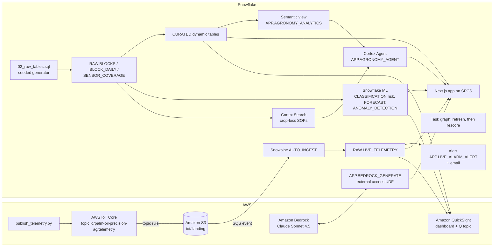

# Indonesia Oil Palm Precision Agriculture - Block Agronomy

Precision agriculture for **30 oil palm blocks of a fictional grower, on estates near 4 Indonesian cities** (Pekanbaru, Medan, Jambi, Palangka Raya), using Snowflake and optionally AWS: from a live soil-moisture alarm to a 7-day crop-loss risk score, an alarm email and an AI action memo. The grower, its blocks and all data are synthetic; nothing here describes the yields or practices of any real company or estate.

## Architecture

A block agronomy pipeline built on **Snowflake** (Dynamic Tables, Snowflake ML, Cortex Search, Cortex Agent, Cortex AI_COMPLETE, SPCS) and, in the full build, **AWS** (IoT Core, S3, Bedrock Claude, QuickSight + Amazon Q). Field-sensor telemetry lands in `RAW.LIVE_TELEMETRY`. Dynamic tables curate 90 days of block-day history: bunches graded ripe at harvest, crop-loss events, FFB harvested, fertilizer applied and fertilizer intensity, pest alerts, sensor network uptime and sensor mapping coverage. Snowflake ML scores 7-day crop-loss risk per block, forecasts grower-wide daily FFB harvest and flags soil moisture deficit anomalies. A Cortex Agent answers questions with SOP citations, and an LLM drafts the agronomy action memo.

Interactive diagrams (hover for object names): [Snowflake only](docs/architecture-snowflake.html) | [AWS + Snowflake](docs/architecture-aws.html). The app shows both on its Architecture & Data tab, the current build first. Regenerate them with `python3 docs/build_architecture.py`.



The Snowflake-only build drops the AWS subgraph: `APP.SIMULATE_TELEMETRY` writes to `RAW.LIVE_TELEMETRY`, and the app calls Cortex `AI_COMPLETE` instead of the Bedrock UDF.

## Snowflake Capabilities

| Capability | Implementation |
|-----------|---------------|
| Dynamic Tables | `CURATED.KPI_SUMMARY`, `PERFORMANCE_SUMMARY`, `CROP_LOSS_CAUSES`, `TREND_ANALYSIS` from the RAW tables |
| Snowflake ML | CLASSIFICATION 7-day crop-loss risk (`ML.CROP_LOSS_RISK_SCORES`), 14-day FFB harvest FORECAST, soil moisture deficit ANOMALY_DETECTION |
| Cortex Search | 21 synthetic crop-loss response SOPs (one per block category and cause) in `SEARCH.AGRONOMY_SOP_SEARCH` |
| Semantic View | `APP.AGRONOMY_ANALYTICS` over blocks, crop-loss causes, daily totals and risk |
| Cortex Agent | `APP.AGRONOMY_AGENT`: Cortex Analyst over the semantic view plus Cortex Search for SOP citations |
| Cortex AI | `AI_COMPLETE('claude-sonnet-4-5')` for grounded answers, and for the action memo in the Snowflake-only build |
| Alerts + Tasks | `APP.LIVE_ALARM_ALERT` logs ALARM readings and sends email; task graph `TASK_REFRESH_CURATED`, then `TASK_RESCORE_RISK` |
| Snowpark Container Services | Next.js app `APP.ID_PALM_OIL_PRECISION_AG_APP` with 6 tabs: Executive Cockpit, Predictive, Block Health, Live IoT, Ask AI, Architecture & Data |
| Snowpipe | `RAW.LIVE_TELEMETRY_PIPE` AUTO_INGEST from S3 (AWS build only) |

## AWS Services

Used only in the AWS + Snowflake build.

| Service | Role in Demo |
|---------|-------------|
| AWS IoT Core | Receives simulated field-sensor telemetry (soil moisture deficit, drain water level). A topic rule writes each message to S3 |
| Amazon S3 | Landing bucket. An event notification goes to the Snowpipe SQS queue |
| Amazon Bedrock | Claude Sonnet 4.5 writes the action memo, called from Snowflake through an external-access UDF |
| Amazon QuickSight | DIRECT_QUERY executive dashboard over Snowflake (daily ripe bunch rate, crop-loss events by block, crop-loss risk) |
| Amazon Q | Natural-language questions over the QuickSight topic `id-palm-oil-precision-ag-topic` |
| AWS IAM | Least-privilege roles for S3, IoT and Bedrock |

## Personas

These personas are fictional.

| Persona | Role | Key Questions |
|---------|------|---------------|
| **Rina Hartono** | VP Plantation Operations | "Which region has the lowest ripe bunch rate?" "Which crop-loss causes leave the most bunches unripe?" |
| **Bayu Saputra** | Estate Agronomist | "Which blocks are high crop-loss risk this week, and which SOP applies?" |

## Data

All data is synthetic and seeded, so every rebuild reproduces it. The grower and block names are fictional; the four cities are real Indonesian places used only as region labels. Thresholds are internal demo thresholds, not agronomic standards, and no figure is a field recommendation.

| Table | Rows | Description |
|-------|------|-------------|
| RAW.BLOCKS | 30 | Blocks across 4 regions and 5 block categories (Young Mature, Prime Mature, Old Mature, Peat Block, Lowland Block), with area and palm age |
| RAW.BLOCK_DAILY | 2,700 | Daily block observations over 90 days: bunches graded and graded ripe, FFB tonnes, fertilizer kg, pest alerts, crop-loss events, root cause, scouting rounds, sensor downtime, soil moisture deficit and drain water level |
| RAW.SENSOR_COVERAGE | 30 | Block hectares and hectares covered by sensor and drone mapping |
| SEARCH.AGRONOMY_SOP_DOCS | 21 | Synthetic crop-loss response SOPs indexed for Cortex Search |
| RAW.LIVE_TELEMETRY | Grows during the demo | Live readings from IoT Core (AWS build) or `APP.SIMULATE_TELEMETRY` (Snowflake-only build) |
| ML.CROP_LOSS_RISK_SCORES | 30 | 7-day crop-loss probability and risk band per block |

## Build Instructions

### Prerequisites
- Snowflake account with ACCOUNTADMIN access, and Cortex AI enabled (AI_COMPLETE, Search, Agent).
- An X-Small warehouse with auto-suspend at or below 120 s, and an existing SPCS compute pool.
- Python 3.11+, `snowflake-connector-python`, Node.js 22+, Docker and the `snow` CLI.
- App image: run `snow spcs image-registry login`, then build and push `id-palm-oil-precision-ag-app:v1` to the database's `APP.IMAGES` repository (see the header of `snowflake/07_deploy_app.sql`).
- AWS build only: `boto3`, AWS credentials for the target account (us-west-2) with Bedrock access, and QuickSight Enterprise.

### SPCS App
```
<DATABASE>.APP.ID_PALM_OIL_PRECISION_AG_APP
```

### Tests
```bash
python -m pytest aws snowflake quicksight
```

For a local run, put `SNOWFLAKE_ACCOUNT`, `SNOWFLAKE_USER`, `SNOWFLAKE_DATABASE`, `SNOWFLAKE_WAREHOUSE`, `SNOWFLAKE_AUTHENTICATOR=PROGRAMMATIC_ACCESS_TOKEN`, `SNOWFLAKE_TOKEN` and `DEMO_PLATFORM` in the environment, then run `npm --prefix app run build && npm --prefix app start`.

## Build Modes

Both modes share the same core. They differ in three places, and the app's `DEMO_PLATFORM` setting (in its SPCS spec) switches the memo provider and the Live IoT tab.

| Layer | Snowflake Only | Full AWS + Snowflake |
|---|---|---|
| Live telemetry | `CALL APP.SIMULATE_TELEMETRY(n)` inserts simulated readings into `RAW.LIVE_TELEMETRY`. This simulates a sensor feed; it is not Snowpipe Streaming | `aws/publish_telemetry.py` to AWS IoT Core, then S3, SQS and Snowpipe AUTO_INGEST |
| Action memo | Cortex `AI_COMPLETE('claude-sonnet-4-5')` | Amazon Bedrock Claude Sonnet 4.5 through `APP.BEDROCK_GENERATE` |
| BI and natural-language questions | The SPCS app is the dashboard; questions go to the Cortex Agent | Also a QuickSight dashboard and an Amazon Q topic |
| App setting | `DEMO_PLATFORM: snowflake` | `DEMO_PLATFORM: aws` |

### Snowflake Only

```bash
# 1. Core data and dynamic tables (guarded: new isolated database only)
python snowflake/run_core.py --database INDONESIA_PALM_OIL_PRECISION_AG_SNOWFLAKE --warehouse <XS_WAREHOUSE> --connection <CONNECTION> --apply
# 2. Native telemetry, ML, search, semantic view, agent, alert and task graph
python snowflake/run_intelligence.py --database INDONESIA_PALM_OIL_PRECISION_AG_SNOWFLAKE --platform snowflake --warehouse <XS_WAREHOUSE> --connection <CONNECTION> --alert-email you@example.com
# 3. App on SPCS with DEMO_PLATFORM=snowflake (push the image first)
python snowflake/run_intelligence.py --database INDONESIA_PALM_OIL_PRECISION_AG_SNOWFLAKE --platform snowflake --warehouse <XS_WAREHOUSE> --connection <CONNECTION> --alert-email you@example.com --files 07_deploy_app.sql --compute-pool <COMPUTE_POOL>
```

During the demo:
- Run `CALL APP.SIMULATE_TELEMETRY(20)` to add live readings. For a continuous feed, run `ALTER TASK APP.TASK_SIMULATE_TELEMETRY RESUME`, and `SUSPEND` it afterwards.
- Run `EXECUTE ALERT APP.LIVE_ALARM_ALERT` to raise the alarm email.
- Run `EXECUTE TASK APP.TASK_REFRESH_CURATED` to refresh the curated tables and rescore risk.

Afterwards, drop the database or run `ALTER SERVICE APP.ID_PALM_OIL_PRECISION_AG_APP SUSPEND`.

### Full AWS + Snowflake

```bash
# 1. Core data and dynamic tables (guarded: new isolated database only)
python snowflake/run_core.py --database INDONESIA_PALM_OIL_PRECISION_AG_AWS --warehouse <XS_WAREHOUSE> --connection <CONNECTION> --apply
# 2. AWS ingestion and Bedrock (dry run first, then --apply)
python aws/setup_aws.py --database INDONESIA_PALM_OIL_PRECISION_AG_AWS --account <AWS_ACCOUNT_ID> --connection <CONNECTION> --apply
# 3. ML, search, semantic view, agent, alert and task graph
python snowflake/run_intelligence.py --database INDONESIA_PALM_OIL_PRECISION_AG_AWS --platform aws --warehouse <XS_WAREHOUSE> --connection <CONNECTION> --alert-email you@example.com
# 4. App on SPCS with DEMO_PLATFORM=aws (push the image first)
python snowflake/run_intelligence.py --database INDONESIA_PALM_OIL_PRECISION_AG_AWS --platform aws --warehouse <XS_WAREHOUSE> --connection <CONNECTION> --alert-email you@example.com --files 07_deploy_app.sql --compute-pool <COMPUTE_POOL>
# 5. QuickSight dashboard and Q topic (needs an existing Snowflake data source)
python quicksight/build_dashboards.py --database INDONESIA_PALM_OIL_PRECISION_AG_AWS --account <AWS_ACCOUNT_ID> --principal-arn <QUICKSIGHT_USER_ARN> --data-source-arn <DATA_SOURCE_ARN> --prefix id-palm-oil-precision-ag --apply --update --with-topic
```

QuickSight objects must be shared with the QuickSight user who signs in (`--principal-arn`); otherwise the console shows nothing.

During the demo:
- Run `python aws/publish_telemetry.py --count 20` to send live readings.
- Run `EXECUTE ALERT APP.LIVE_ALARM_ALERT` to raise the alarm email.
- Run `EXECUTE TASK APP.TASK_REFRESH_CURATED` to refresh the curated tables and rescore risk.

Afterwards, `python aws/teardown_aws.py --database INDONESIA_PALM_OIL_PRECISION_AG_AWS --account <AWS_ACCOUNT_ID> --connection <CONNECTION> --apply` removes the AWS resources and the account-level Bedrock external-access and S3 storage integrations. It leaves the email integration `ID_PALM_OIL_PRECISION_AG_EMAIL_INT`, which the Snowflake-only build also uses.

## Business Impact

Industry context:
- **Indonesia is the world's largest palm oil producer**: 46.7 million metric tons in marketing year 2025, 57.3% of global production, from about 14 million harvested hectares -- [USDA Foreign Agricultural Service, Production - Palm Oil](https://www.fas.usda.gov/data/production/commodity/4243000)

## Key Demo Numbers

These figures are synthetic and come from the seeded demo data. Forecast and anomaly figures can shift slightly with the build day.

- **30 blocks**, 2,700 block-days over 90 days, across 4 regions and 5 block categories (1,226.8 ha); **5,214 t of FFB** harvested and **48,570 bunches graded**
- **Ripe bunch rate 87.7%**; per-block values range from 80.3% to 90.9%, and Palangka Raya is the lowest region at 87.0%
- **447 crop-loss events** across 13 root causes; water table drawdown leaves the most bunches unripe
- **Fertilizer intensity 67.0 kg/t FFB** (349,497 kg applied in total); Young Mature blocks are highest at 81.5 kg/t and Prime Mature blocks lowest at 55.4 kg/t
- **Crop-loss risk model** out-of-time holdout: precision 0.56, recall 0.66 at a 0.5 threshold, against a 0.48 base rate. 23 blocks are high risk; the top block is BLK-0014, at 96.4%
- **14-day FFB harvest forecast** with prediction intervals (44.0 to 60.3 t per day); **41 of 480** block-days flagged as soil moisture deficit anomalies
- **Sensor network uptime 97.8%**, sensor mapping coverage 50.6%, 84 pest alerts
- **21 SOPs** indexed for Cortex Search and cited by ID in agent answers


## License

Apache 2.0 — See [LICENSE](LICENSE) for details.

This is a personal demo project and is not an official Snowflake offering. It comes with no support or warranty. The grower, blocks and figures are synthetic and do not describe any real company or estate. Industry statements cited are from publicly available third-party sources; they are context, not guarantees of results.
